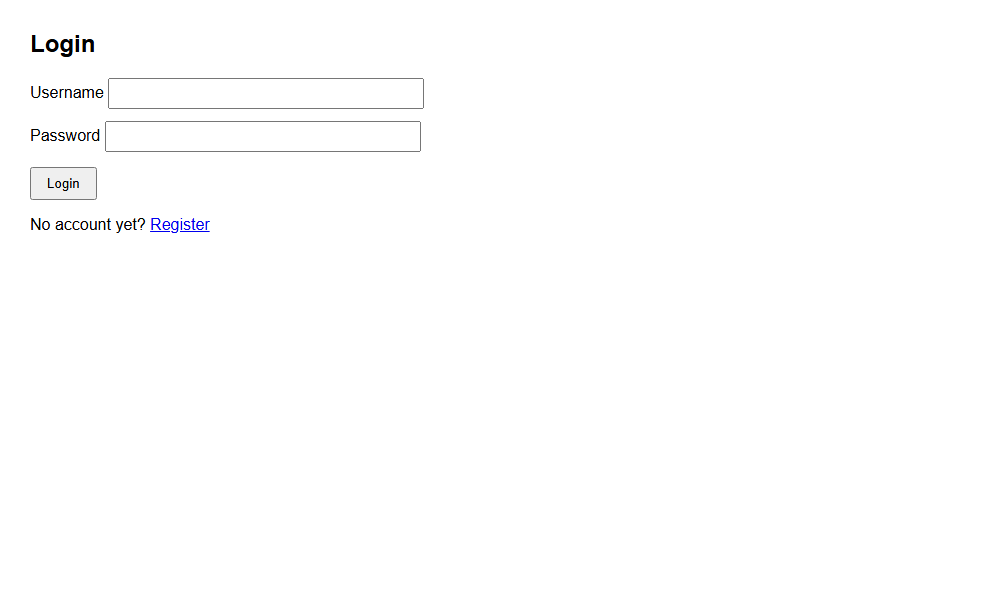
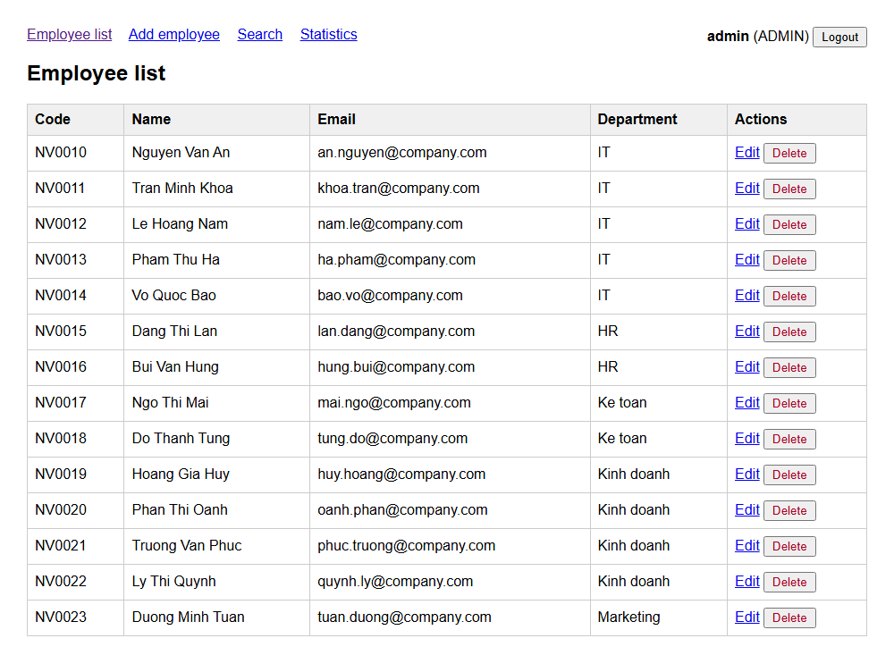
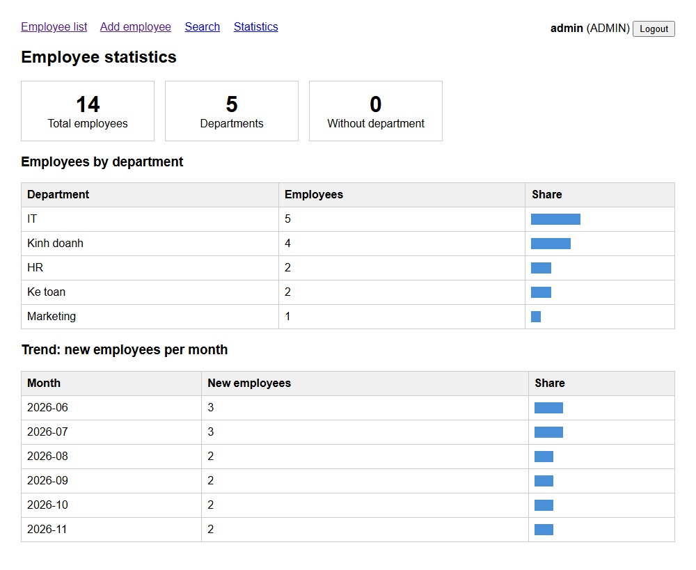

# MiniProject: Employee Management System

Hệ thống quản lý nhân viên xây dựng bằng Spring Boot, làm theo lộ trình học Spring Boot

## Chức năng chính

- Quản lý nhân viên: xem danh sách, thêm, sửa, xóa, tìm kiếm theo tên hoặc phòng ban
- Quản lý phòng ban
- Đăng ký, đăng nhập (form đăng nhập cho web, JWT cho API)
- Phân quyền: `USER` chỉ được xem, `ADMIN` được thêm, sửa, xóa
- Thống kê: số nhân viên theo phòng ban, tổng số nhân viên, xu hướng nhân viên mới theo tháng
- Giao diện web bằng Thymeleaf và REST API

## Công nghệ

Spring Boot 3.3, Spring Data JPA, Spring Security (JWT), Thymeleaf, MySQL, Actuator, Caching, Scheduling, Logging (SLF4J + Logback), Java 17, Maven.

## Hình ảnh

Đăng nhập:

Danh sách nhân viên (ADMIN, có nút Edit và Delete):

Thống kê theo phòng ban và xu hướng theo tháng:

Chi tiết API, phân quyền, profile dev/prod và ảnh từng module xem tại [employee-management/README.md](employee-management/README.md).
