# Employee Management System

Spring Boot 3.3 + Spring Data JPA + MySQL + Thymeleaf.

## Run

1. Start MySQL. The database `employee_db` is created automatically (dev profile: user `root`, password `12345`).
2. `mvn spring-boot:run` (profile `dev` is active by default, tables are created automatically).
3. Production profile: set `DB_URL`, `DB_USERNAME`, `DB_PASSWORD`, `JWT_SECRET` and run with `-Dspring-boot.run.profiles=prod`.

## Security (Module 9)

Every API and web page requires login. A default admin account is created at startup:
username `admin`, password `admin123` (change it for any real deployment).

| Role | Permissions |
|---|---|
| `USER` | View only (GET employees, departments, report, web list/search) |
| `ADMIN` | Everything: create, update, delete employees and departments, add form, actuator |

Anyone can register (`POST /api/auth/register`), the new account always gets the role `USER`.

| Method | URL | Description |
|---|---|---|
| POST | `/api/auth/register` | Register `{ "username", "password" }` (3+ chars, 6+ chars), returns a JWT |
| POST | `/api/auth/login` | Login `{ "username", "password" }`, returns `{ "token", "username", "role" }` |

Two ways to authenticate:
- **JWT** for the API: send `Authorization: Bearer <token>` (token valid for 1 hour).
- **Basic Authentication** for the web pages: the browser shows a login popup.

Status codes: `401` not logged in or wrong password, `403` logged in but not allowed, `409` username already exists.

## API

| Method | URL | Description |
|---|---|---|
| GET | `/api/departments` | List departments |
| GET/PUT/DELETE | `/api/departments/{id}` | Get / update / delete a department |
| POST | `/api/departments` | Create `{ "name": "IT" }` |
| GET | `/api/employees?name=&department=&departmentId=` | List / search employees |
| GET/PUT/DELETE | `/api/employees/{id}` | Get / update / delete an employee |
| POST | `/api/employees` | Create `{ "name", "email", "password", "departmentId" }` |
| GET | `/api/reports/employee-count` | Total number of employees (cached for 1 minute) |

## Web pages

`/employees/list`, `/employees/add`, `/employees/search`

## Module 8: Actuator, Scheduling, Caching

### Actuator (health, metrics)

Exposed endpoints: `/actuator/health`, `/actuator/metrics`, `/actuator/info`.

`GET /actuator/health` (status UP, database MySQL UP):

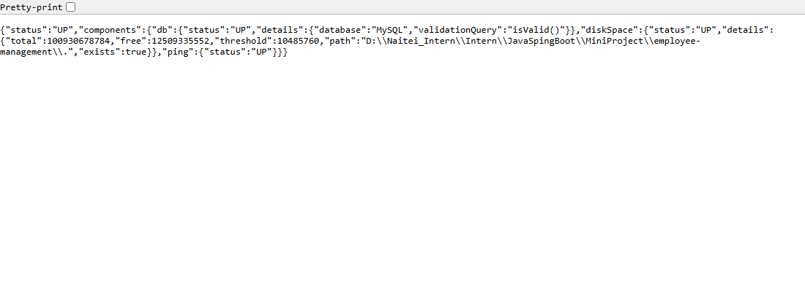

`GET /actuator/metrics/jvm.memory.used`:

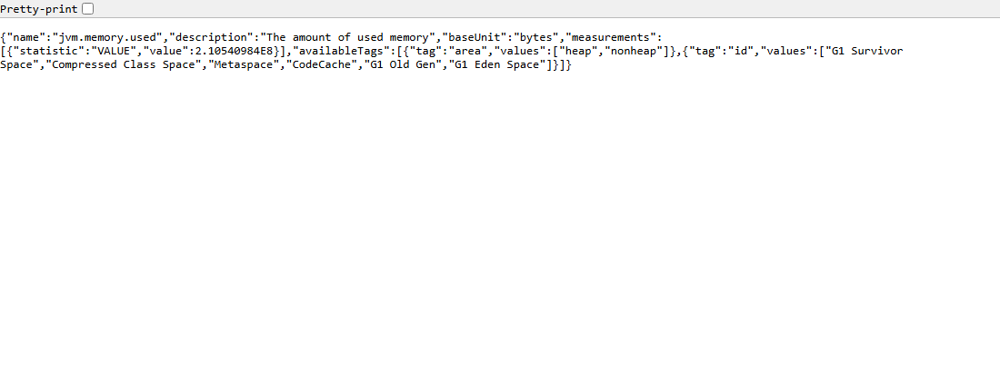

### Report API with caching (1 minute)

`GET /api/reports/employee-count` is annotated with `@Cacheable` (Caffeine, `expireAfterWrite=1m`).
Calling it twice within a minute returns the same `generatedAt`, so the second call did not hit the database.

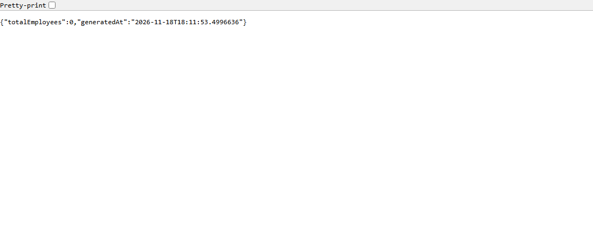

### Scheduled task

`SystemScheduler` logs `System running` every 30 seconds (`@Scheduled(fixedRate = 30000)`).
The `cache miss` line appears only for the first report request; the next calls within one minute are served from the cache.


## Module 9 evidence: Spring Security

### Real application log

Register, wrong password, `401` without token, `403` when a USER tries to create or delete, and the admin actions:

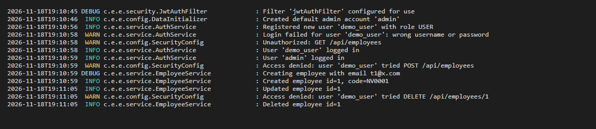

### API tests (JWT)

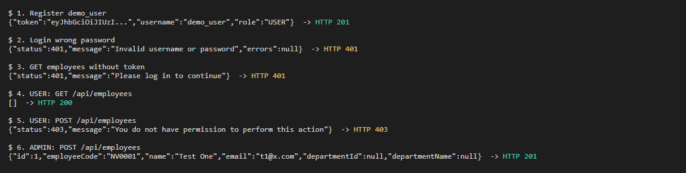

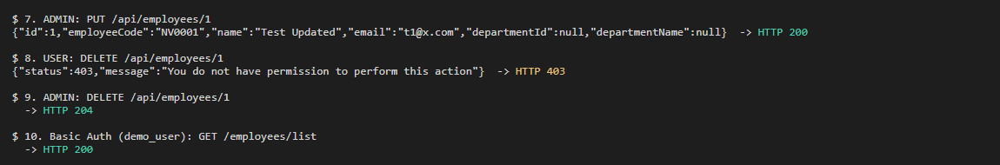

### Web pages (Basic Authentication)

USER `demo_user` sees the list, and the "Add employee" link is hidden:

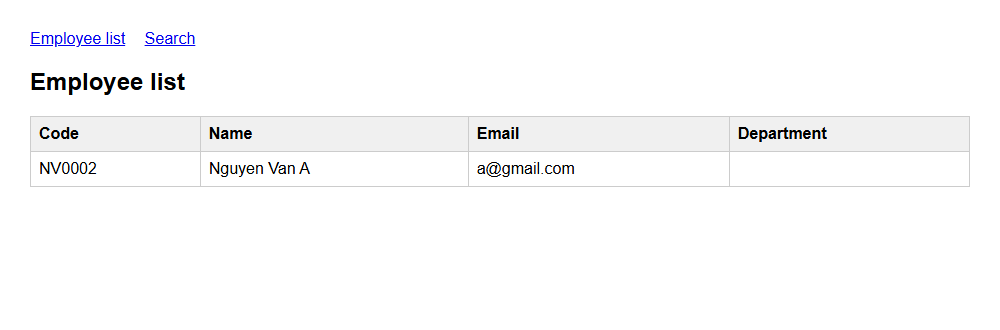

USER opening `/employees/add` gets `403`:

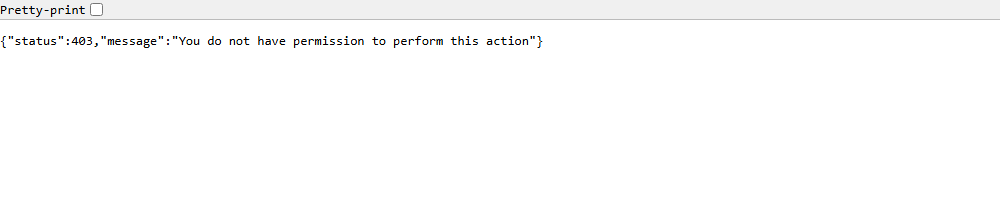

ADMIN sees the "Add employee" link and the form:

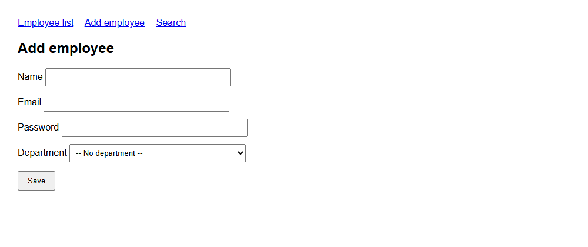

Note: since Module 9 the actuator endpoints `/actuator/metrics` and `/actuator/info` require the ADMIN role (`/actuator/health` stays public). The Module 8 screenshots above were taken before security was added.

## Module 10: Reporting & Analytics

### Statistics API

`GET /api/statistics` (roles USER and ADMIN) returns the total number of employees, the number of employees without a department, and the number of employees in each department:

```json
{
  "totalEmployees": 14,
  "employeesWithoutDepartment": 0,
  "byDepartment": [
    { "departmentName": "IT", "employeeCount": 5 },
    { "departmentName": "Kinh doanh", "employeeCount": 4 },
    { "departmentName": "HR", "employeeCount": 2 },
    { "departmentName": "Ke toan", "employeeCount": 2 },
    { "departmentName": "Marketing", "employeeCount": 1 }
  ]
}
```

The numbers are calculated with `@Query` methods in the repositories (`COUNT` + `LEFT JOIN` + `GROUP BY`), so departments without employees are also listed with 0.

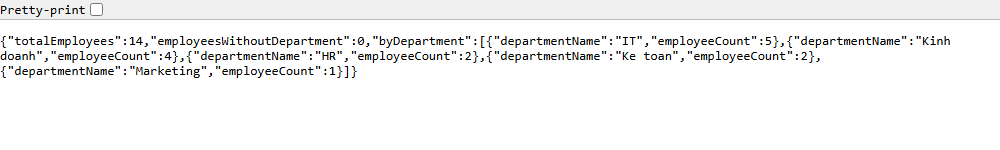

### Statistics page

`/employees/statistics` shows the same data with Thymeleaf: summary cards and a table with a bar for each department.

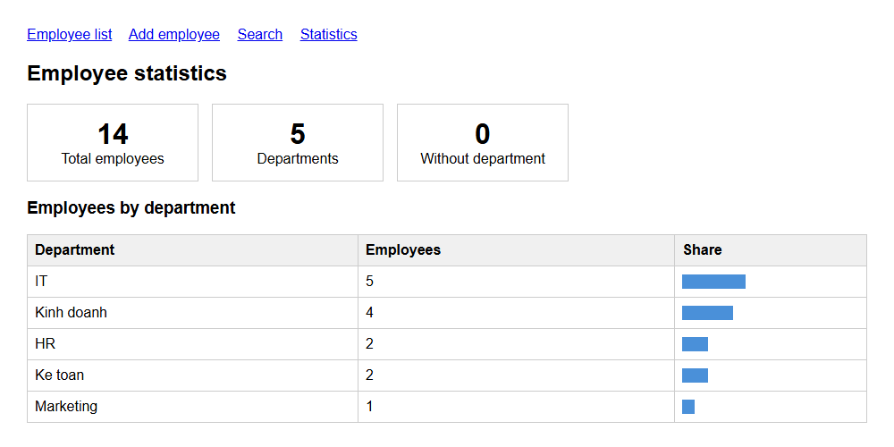

The screenshot above was taken as ADMIN. The page is also available to the USER role (the "Add employee" link is hidden):

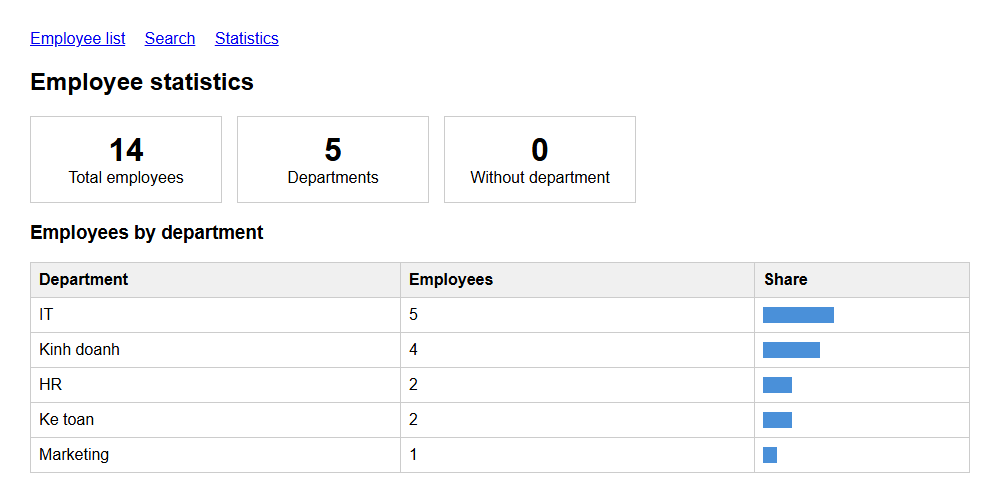

### Log and generated SQL

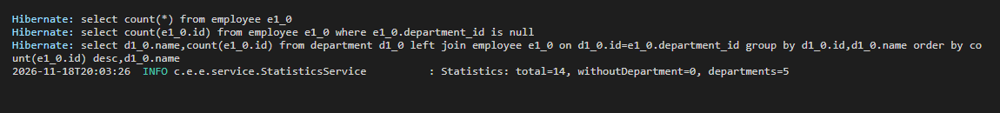

The screenshots were taken with the sample data in the database (14 employees in 5 departments), created through the API.
