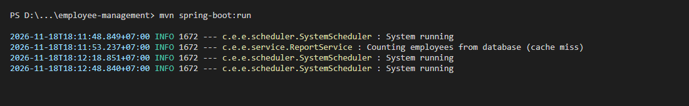

# Employee Management System

Spring Boot 3.3 + Spring Data JPA + MySQL + Thymeleaf.

## Run

1. Start MySQL. The database `employee_db` is created automatically (dev profile: user `root`, password `12345`).
2. `mvn spring-boot:run` (profile `dev` is active by default, tables are created automatically).
3. Production profile: set `DB_URL`, `DB_USERNAME`, `DB_PASSWORD` and run with `-Dspring-boot.run.profiles=prod`.

## API

| Method | URL | Description |
|---|---|---|
| GET | `/api/departments` | List departments |
| GET/PUT/DELETE | `/api/departments/{id}` | Get / update / delete a department |
| POST | `/api/departments` | Create `{ "name": "IT" }` |
| GET | `/api/employees?name=&department=&departmentId=` | List / search employees |
| GET/PUT/DELETE | `/api/employees/{id}` | Get / update / delete an employee |
| POST | `/api/employees` | Create `{ "name", "email", "password", "departmentId" }` |
| GET | `/api/reports/employee-count` | Total number of employees (cached for 1 minute) |

## Web pages

`/employees/list`, `/employees/add`, `/employees/search`

## Module 8: Actuator, Scheduling, Caching

### Actuator (health, metrics)

Exposed endpoints: `/actuator/health`, `/actuator/metrics`, `/actuator/info`.

`GET /actuator/health` (status UP, database MySQL UP):

`GET /actuator/metrics/jvm.memory.used`:

### Report API with caching (1 minute)

`GET /api/reports/employee-count` is annotated with `@Cacheable` (Caffeine, `expireAfterWrite=1m`).
Calling it twice within a minute returns the same `generatedAt`, so the second call did not hit the database.

### Scheduled task

`SystemScheduler` logs `System running` every 30 seconds (`@Scheduled(fixedRate = 30000)`).
The `cache miss` line appears only for the first report request; the next calls within one minute are served from the cache.

